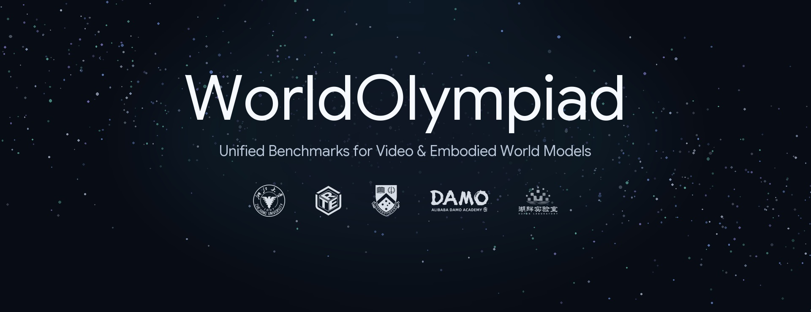
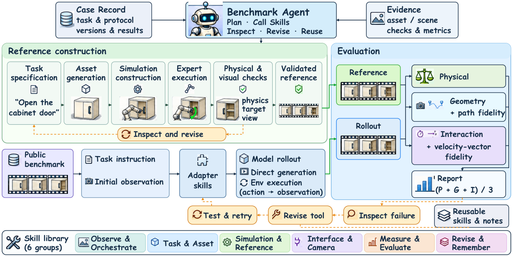
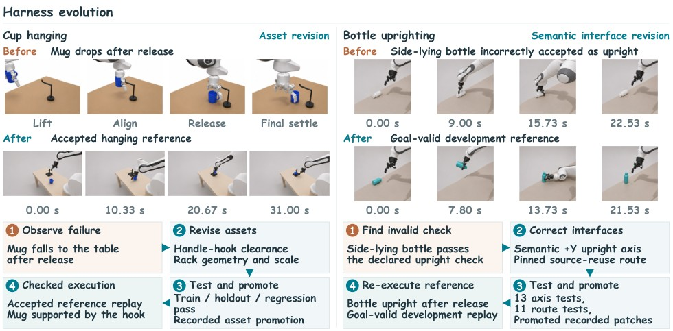
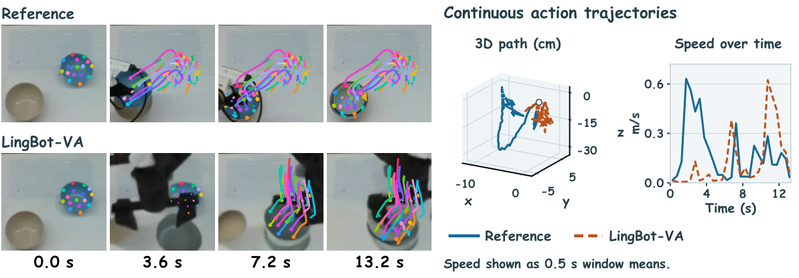
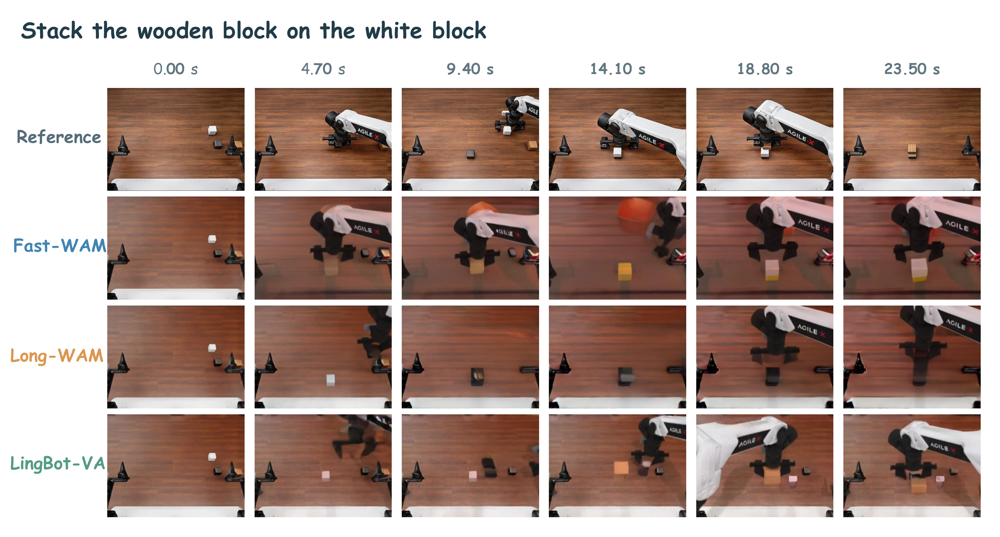
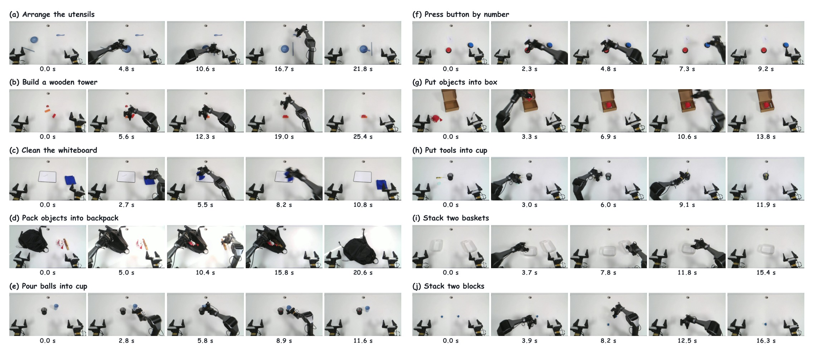
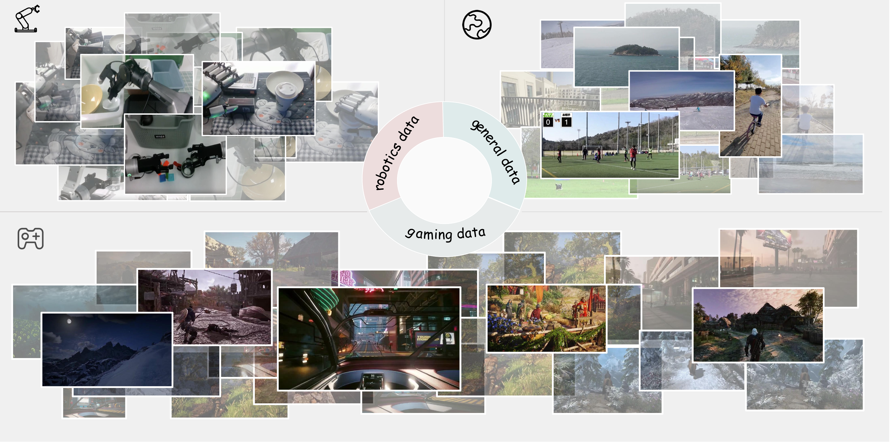
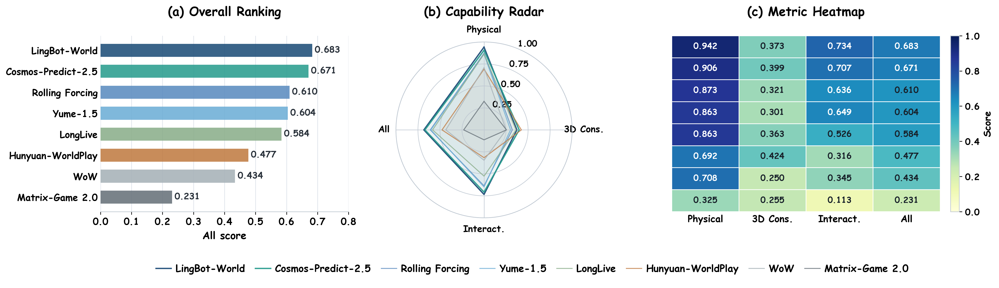

<div align="center">

<h1>🏆 WorldOlympiad</h1>

<p><b>A Flagship Benchmark Series for Diagnosing Video &amp; Embodied World Models</b></p>

<p>
  <a href="https://alibaba-damo-academy.github.io/WorldOlympiad"></a>
  <a href="https://github.com/alibaba-damo-academy/WorldOlympiad/tree/v1"></a>
  <a href="https://github.com/alibaba-damo-academy/WorldOlympiad/tree/v2"></a>
  <a href="https://huggingface.co/datasets/Chengzhiwww/WorldOlympiad2.0"></a>
  <a href="README_ZH.md"></a>
</p>

<br>



<br>

<table>
  <tr>
    <td align="center" width="25%"><b>2,100+</b><br><sub>Benchmark Cases (1.0 &amp; 2.0)</sub></td>
    <td align="center" width="25%"><b>300</b><br><sub>Real-Robot Bimanual Demos</sub></td>
    <td align="center" width="25%"><b>13</b><br><sub>Evaluated World Models</sub></td>
    <td align="center" width="25%"><b>ρ = 0.90–0.95</b><br><sub>Human Preference Alignment</sub></td>
  </tr>
</table>

</div>

<br>

> [!IMPORTANT]
> 🚀 **We just released WorldOlympiad 2.0!**  
> Introducing **WorldOlympiad 2.0** (*Evaluating Embodied World Models with a Self-Evolving Agent Harness and Continuous Action Evaluation*) — featuring **1,100** benchmark cases, **300** newly collected AgileX Piper bimanual real-robot demos, **2,500** native-protocol rollouts, and plug-and-play **Auto-Adapter** & **HF Dataset Router** agent skills.  
> 👉 Explore the [**Project Page (`#v2`)**](https://alibaba-damo-academy.github.io/WorldOlympiad/#v2) · [**`v2` Codebase**](https://github.com/alibaba-damo-academy/WorldOlympiad/tree/v2) · [**HuggingFace Dataset**](https://huggingface.co/datasets/Chengzhiwww/WorldOlympiad2.0)

> **Can a generative model act as a true world simulator—not just a visually plausible video synthesizer?**  
> **WorldOlympiad** pushes world-model evaluation beyond pixels: from **WorldOlympiad 1.0**'s multi-domain video triathlon (**Physical · 3D Geometry · Interaction**) to **WorldOlympiad 2.0**'s **Self-Evolving Agent Harness** and **Continuous Action Evaluation (CAE)** for embodied manipulation.

---

## ✨ WorldOlympiad 2.0 — Embodied World Models (`v2`)

> **WorldOlympiad 2.0: Evaluating Embodied World Models with a Self-Evolving Agent Harness and Continuous Action Evaluation**

<p>
  <a href="https://alibaba-damo-academy.github.io/WorldOlympiad/#v2"></a>
  <a href="#"></a>
  <a href="https://github.com/alibaba-damo-academy/WorldOlympiad/tree/v2"></a>
  <a href="https://huggingface.co/datasets/Chengzhiwww/WorldOlympiad2.0"></a>
  <a href="README_ZH.md"></a>
</p>

### 🔁 Self-Evolving Agent Harness
Instead of brittle one-off evaluation scripts, one closed-loop **Benchmark Agent** orchestrates task synthesis, physics validation, native multi-model rollout, and three-track + CAE scoring—automatically diagnosing and repairing faulty assets and goal predicates through regression tests *before* scoring any model under frozen rules.

<p align="center">
  
</p>

<p align="center">
  
  <br><sub><i>Closed-loop asset &amp; predicate repair: fixing cup-hanging hook clearance and bottle-uprighting +Y goal checks before scoring.</i></sub>
</p>

### 🎯 Continuous Action Evaluation (CAE)
Frame-level judges can be fooled by crisp visual polish even when an object barely moves or stalls between action chunks. **CAE** recovers 3D object trajectories directly from RGB at **native frame rates** (e.g., 30 fps vs. 10 fps) without resampling—cleanly separating **path fidelity ($S_{\mathrm{path}}$)** from **velocity pacing ($S_{\mathrm{vel}}$)**.

<p align="center">
  
</p>

### 🤖 Multi-Model Rollouts &amp; Newly Collected Real-Robot Suite
**2,500 native-protocol rollouts** across 5 embodied world models (`GR00T N1.6`, `LingBot-VA`, `Long-WAM`, `Fast-WAM`, `Cosmos3`) plus **300 newly collected AgileX Piper bimanual demonstrations** across 10 long-horizon manipulation tasks.

<p align="center">
  
</p>

<p align="center">
  
  <br><sub><i>Interactive video gallery, 11-dimension radar &amp; fine-grained breakdowns available on the <a href="https://alibaba-damo-academy.github.io/WorldOlympiad/#v2">Project Page →</a></i></sub>
</p>

---

## 🏅 WorldOlympiad 1.0 — Video World Models (`v1`)

> **WorldOlympiad: Can Your World Model Survive a Triathlon?** ([arXiv:2606.11129](https://arxiv.org/abs/2606.11129))

<p>
  <a href="https://alibaba-damo-academy.github.io/WorldOlympiad/#v1"></a>
  <a href="https://arxiv.org/abs/2606.11129"></a>
  <a href="https://github.com/alibaba-damo-academy/WorldOlympiad/tree/v1"></a>
  <a href="https://huggingface.co/datasets/ziplab/WorldOlympiad"></a>
  <a href="https://github.com/alibaba-damo-academy/WorldOlympiad/blob/v1/README_ZH.md"></a>
</p>

A triathlon-style benchmark evaluating **8 video world models** across **1,000 long videos** (400 robotics, 400 gaming, 200 real-world) on **Physical Faithfulness**, **3D Geometric Consistency**, and **Interaction Fidelity** (**Spearman $\rho = 0.95$**).

<p align="center">
  
</p>

<p align="center">
  
</p>

---

## 🧭 Repository Branches &amp; Quick Start

All codebases are isolated on dedicated branches so you can check out the exact release you need:

| Version | Branch | Focus | Quick Links |
| :--- | :---: | :--- | :--- |
| **WorldOlympiad 2.0** | [**`v2`**](https://github.com/alibaba-damo-academy/WorldOlympiad/tree/v2) | Embodied world models, Self-Evolving Harness, CAE, Auto-Adapter &amp; HF Dataset Router Skills | [**Code (`v2`) →**](https://github.com/alibaba-damo-academy/WorldOlympiad/tree/v2) · [Guide](docs/v2-guide.md) · [Web (`#v2`)](https://alibaba-damo-academy.github.io/WorldOlympiad/#v2) |
| **WorldOlympiad 1.0** | [**`v1`**](https://github.com/alibaba-damo-academy/WorldOlympiad/tree/v1) | Video world model triathlon benchmark (Robotics / Gaming / Real-World) | [**Code (`v1`) →**](https://github.com/alibaba-damo-academy/WorldOlympiad/tree/v1) · [Guide](docs/v1-guide.md) · [Web (`#v1`)](https://alibaba-damo-academy.github.io/WorldOlympiad/#v1) |
| **Project Website** | [**`website`**](https://github.com/alibaba-damo-academy/WorldOlympiad/tree/website) | Unified 1.0 &amp; 2.0 interactive project page (GitHub Pages) | [**Live Site →**](https://alibaba-damo-academy.github.io/WorldOlympiad) |

```bash
# Clone WorldOlympiad 2.0
git clone -b v2 https://github.com/alibaba-damo-academy/WorldOlympiad.git

# Clone WorldOlympiad 1.0
git clone -b v1 https://github.com/alibaba-damo-academy/WorldOlympiad.git
```

---

## 📚 Documentation Hub (`docs/`)

| Category | Document | Link |
| :--- | :--- | :--- |
| **Quickstarts** | WorldOlympiad 2.0 · WorldOlympiad 1.0 | [docs/v2-guide.md](docs/v2-guide.md) · [docs/v1-guide.md](docs/v1-guide.md) |
| **Agent Skills (`v2`)** | Self-Evolving Auto Model Adapter · HF Dataset Router | [Auto-Adapter](https://github.com/alibaba-damo-academy/WorldOlympiad/blob/v2/.agents/skills/wov2-auto-model-adapter/SKILL.md) · [HF Router](https://github.com/alibaba-damo-academy/WorldOlympiad/blob/v2/.agents/skills/wov2-hf-dataset-router/SKILL.md) |
| **Specifications** | Benchmark Contract · Host Migration Guide | [docs/benchmark.md](docs/benchmark.md) · [docs/migration-v1.md](docs/migration-v1.md) |
| **Validation** | Acceptance Criteria · Multi-Model Routing Records | [docs/acceptance.md](docs/acceptance.md) · [docs/native-multimodel-validation.md](docs/native-multimodel-validation.md) |

---

## 📖 Citation

<details>
<summary><b>WorldOlympiad 2.0 (2026)</b></summary>

```bibtex
@article{wang2026worldolympiad2,
  title   = {WorldOlympiad 2.0: Evaluating Embodied World Models with a Self-Evolving Agent Harness and Continuous Action Evaluation},
  author  = {Chengzhi Wang and Yuke Zhao and Zanyang Huang and Zeyu Zhang and
             Shiyuan Zhang and Weijie Wang and Akide Liu and Jiasheng Tang and
             Yinghao Yu and Bohan Zhuang},
  year    = {2026}
}
```
</details>

<details>
<summary><b>WorldOlympiad 1.0 (arXiv:2606.11129)</b></summary>

```bibtex
@misc{zhao2026worldolympiadworldmodelsurvive,
  title         = {WorldOlympiad: Can Your World Model Survive a Triathlon?},
  author        = {Yuke Zhao and Wangbo Zhao and Weijie Wang and Zeyu Zhang and
                   Dakai An and Akide Liu and Yinghao Yu and Jiasheng Tang and
                   Fan Wang and Wei Wang and Bohan Zhuang},
  year          = {2026},
  eprint        = {2606.11129},
  archivePrefix = {arXiv},
  primaryClass  = {cs.CV},
  url           = {https://arxiv.org/abs/2606.11129}
}
```
</details>
