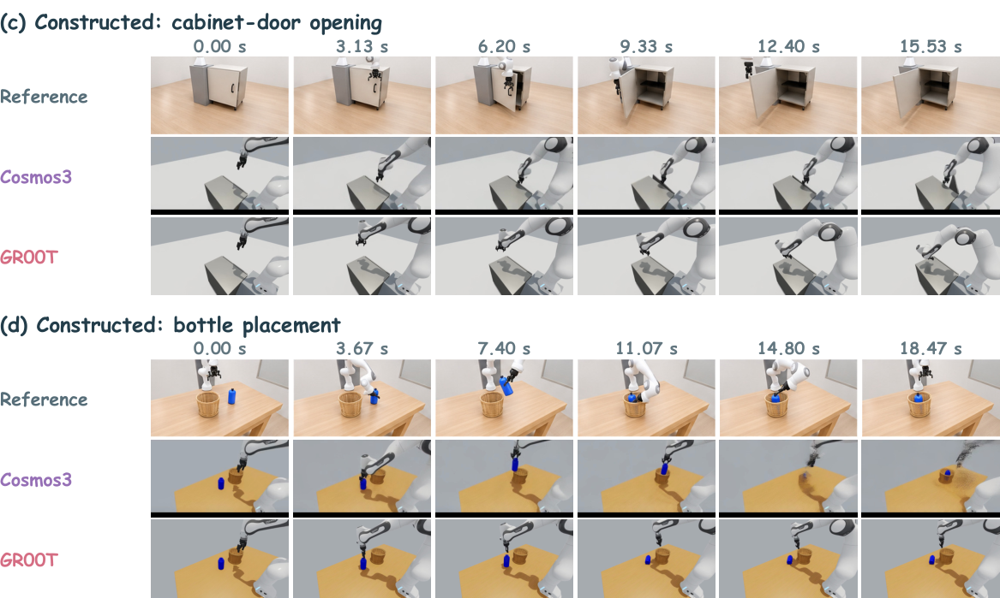

<div align="center">

<h1>WorldOlympiad 2.0: Evaluating Embodied World Models with a Self-Evolving Agent Harness and Continuous Action Evaluation</h1>

<p>
  <b>Chengzhi Wang</b><sup>1,*</sup>,
  <b>Yuke Zhao</b><sup>1,*</sup>,
  <b>Zanyang Huang</b><sup>1</sup>,
  <b>Zeyu Zhang</b><sup>2,†</sup>,
  <b>Shiyuan Zhang</b><sup>1</sup>,<br>
  <b>Weijie Wang</b><sup>1</sup>,
  <b>Akide Liu</b><sup>3</sup>,
  <b>Jiasheng Tang</b><sup>4,5</sup>,
  <b>Yinghao Yu</b><sup>2</sup>,
  <b>Bohan Zhuang</b><sup>1,4,‡</sup>
</p>

<p>
  <sup>1</sup> Zhejiang University &nbsp;·&nbsp;
  <sup>2</sup> TRE, Alibaba Group &nbsp;·&nbsp;
  <sup>3</sup> Monash University &nbsp;·&nbsp;
  <sup>4</sup> DAMO Academy, Alibaba Group &nbsp;·&nbsp;
  <sup>5</sup> Hupan Lab<br>
  <sub><sup>*</sup> Equal contribution &nbsp;·&nbsp; <sup>†</sup> Project lead &nbsp;·&nbsp; <sup>‡</sup> Corresponding author</sub>
</p>

<p>
  <a href="https://alibaba-damo-academy.github.io/WorldOlympiad/#v2"></a>
  <a href="#"></a>
  <a href="https://github.com/alibaba-damo-academy/WorldOlympiad/tree/v2"></a>
  <a href="https://huggingface.co/datasets/Chengzhiwww/WorldOlympiad2.0"></a>
  <a href="README_ZH.md"></a>
</p>

<br>

<a href="https://alibaba-damo-academy.github.io/WorldOlympiad/assets/v2/video/promo_web.mp4">
  
</a>
<p><sub>🎬 <a href="https://alibaba-damo-academy.github.io/WorldOlympiad/assets/v2/video/promo_web.mp4"><b>Play Full 1080p Promo Video with Audio (1:26, MP4)</b></a> &nbsp;·&nbsp; <a href="https://alibaba-damo-academy.github.io/WorldOlympiad/#v2">Explore Interactive Project Page &amp; 39 Live Videos →</a></sub></p>

<br>

<table>
  <tr>
    <td align="center" width="25%"><b>1,100</b><br><sub>Benchmark Cases<br>(900 Public · 200 Constructed)</sub></td>
    <td align="center" width="25%"><b>300</b><br><sub>Newly Collected Real-Robot<br>Bimanual Demos</sub></td>
    <td align="center" width="25%"><b>2,500</b><br><sub>Native-Protocol Rollouts<br>(5 Embodied World Models)</sub></td>
    <td align="center" width="25%"><b>ρ = 0.90</b><br><sub>Human Preference Alignment<br>(10 Human Raters)</sub></td>
  </tr>
</table>

</div>

<br>

> **Visual polish alone does not make an embodied world model a reliable simulator.**  
> **WorldOlympiad 2.0** introduces a **Self-Evolving Agent Harness** that automates physics-verified benchmark construction, asset/predicate repair, and native multi-model evaluation, paired with **Continuous Action Evaluation (CAE)** to measure 3D object paths and velocity pacing at each model's native frame rate.

---

## 🎬 Live Visual Showcase

<p align="center">
  
  <br><sub><i>Top: newly collected AgileX Piper bimanual real-robot demonstrations. Bottom: physics-verified PBR constructed manipulation tasks. Watch all 39 interactive video clips on the <a href="https://alibaba-damo-academy.github.io/WorldOlympiad/#v2">Project Page →</a></i></sub>
</p>

---

## 🔁 Self-Evolving Agent Harness

Rather than relying on brittle, hand-written evaluation scripts, a single closed-loop **Benchmark Agent** orchestrates task synthesis (`SceneCode` + PyBullet), physics & goal-predicate verification, native model rollouts, and three-track + CAE scoring. When an asset collision or faulty predicate breaks a reference task, the agent diagnoses the failure, repairs the code/skill, and passes regression tests **before** scoring any model under frozen rules.

<p align="center">
  
</p>

<p align="center">
  
  <br><sub><i>Closed-loop repair before scoring: resolving cup-hanging hook clearance collisions and bottle-uprighting +Y orientation predicates automatically.</i></sub>
</p>

---

## 🎯 Continuous Action Evaluation (CAE)

Frame-level visual metrics can award high scores to visually crisp rollouts whose manipulated objects barely move or stall between action chunks. **CAE** tracks dense 3D object particles directly from RGB video at each model's **native frame rate** (e.g., 30 fps vs. 10 fps) without temporal resampling—separating **Path Fidelity ($S_{\mathrm{path}}$)** from **Velocity Pacing ($S_{\mathrm{vel}}$)**.

<p align="center">
  
  <br><sub><i>Native-FPS 3D particle flow tracking comparing the Ground-Truth Reference trajectory (left) against a Cosmos3 rollout (right).</i></sub>
</p>

<p align="center">
  
</p>

---

## 🤖 Multi-Model Rollouts & Newly Collected Real-Robot Suite

We evaluate **5 representative embodied world models** (`GR00T N1.6`, `LingBot-VA`, `Long-WAM`, `Fast-WAM`, `Cosmos3`) across **2,500 native-protocol rollouts** spanning **900 public benchmark cases** (`RoboDojo`, `ManiSkill3`, `Table30`, `RoboCOIN`, `RoboMIND`) and **200 physics-verified constructed scenes** (`ARX5` dual-arm & `Panda` single-arm), alongside **300 newly collected AgileX Piper bimanual real-robot demonstrations** across 10 long-horizon manipulation tasks.

<p align="center">
  
</p>

<p align="center">
  
</p>

<p align="center">
  
</p>

---

## 🏆 Leaderboard & Human Alignment

| Rank | Model | Overall | Physical ($P$) | 3D Geometry ($G$) | Interaction ($I$) | CAE Path ($S_{\mathrm{path}}$) | CAE Vel ($S_{\mathrm{vel}}$) | Human Score |
| :---: | :--- | :---: | :---: | :---: | :---: | :---: | :---: | :---: |
| 🥇 | **GR00T N1.6** | **0.643** | **0.920** | **0.547** | **0.460** | 0.239 | 0.146 | 0.595 |
| 🥈 | **LingBot-VA** | 0.519 | 0.735 | 0.388 | 0.433 | 0.246 | 0.159 | **0.608** |
| 🥉 | **Long-WAM** | 0.496 | 0.726 | 0.390 | 0.373 | 0.243 | 0.157 | 0.512 |
| 4 | **Fast-WAM** | 0.454 | 0.702 | 0.340 | 0.320 | 0.242 | 0.156 | 0.487 |
| 5 | **Cosmos3** | 0.439 | 0.685 | 0.342 | 0.289 | **0.382** | **0.183** | 0.435 |

> **Key Takeaway**: Across 10 human raters, WorldOlympiad 2.0 achieves **Spearman $\rho = 0.90$** alignment—and reveals a critical decoupling: visual fidelity leaders (`GR00T N1.6`) can lag behind in continuous 3D motion pacing, whereas trajectory-faithful rollouts (`Cosmos3`) excel on CAE ($S_{\mathrm{path}} = 0.382$, $S_{\mathrm{vel}} = 0.183$). Explore the interactive 11-dimension radar & task-family matrix on the [Project Page →](https://alibaba-damo-academy.github.io/WorldOlympiad/#v2)

---

## Repository Layout

```text
WorldOlympiad (branch: v2)
  .agents/skills/                 # built-in agent skills (pipeline, HF dataset router, auto-adapter)
  CLAUDE.md                       # repository rules automatically loaded by coding agents
  setup.sh                        # unified CLI for setup, data routing, agent runs, and scoring
  scripts/                        # CLI entrypoints (configure, set_api_key, hf_dataset_router, benchmark)
  code/                           # Benchmark Agent, SceneCode, Depth-Anything-3, CuRobo, and native adapters
  assets/                         # portable URDF and robot asset bundles (SHA-256 locked)
  docs/                           # benchmark contract schemas and README figures
```

## Installation & Configuration

Full GPU evaluation targets Linux x86_64 with NVIDIA CUDA 12.8, `python3.10`, `python3.11`, and `uv`.

### 1. Clone, Runtimes & Auxiliary Scoring Weights

Run these steps once on a fresh GPU host:

```bash
git clone -b v2 https://github.com/alibaba-damo-academy/WorldOlympiad.git WorldOlympiad-v2
cd WorldOlympiad-v2

# Verify bundled sources and materialize portable robot assets
./setup.sh sources-verify
python3 scripts/setup_robot_assets.py

# Install isolated Python 3.10/3.11 runtimes and auxiliary scoring weights (VLM, DA3, SAM, CLIP)
export WOV2_GPU_ALLOWLIST=0,1
./setup.sh robotwin-assets-download
./setup.sh runtime --online-install
mkdir -p ./weights_cache
./setup.sh weights-fetch-aux --shared-root ./weights_cache
```

If your machine already has compatible environments or shared weights, reuse them directly instead of reinstalling:

```bash
./setup.sh runtime-reuse --server-root /path/to/compatible/WOV2
./setup.sh weights-reuse --shared-root /path/to/shared_weights
```

### 2. Configure GPT API & Model Profile

WorldOlympiad 2.0 separates the **GPT / OpenAI-compatible Agent API** (used by the Benchmark Agent and SceneCode) from the **local tested world model**:

```bash
./setup.sh configure \
  --agent-base-url https://api.openai.com/v1 \
  --agent-model gpt-5.6-sol \
  --tested-model lingbot_va \
  --checkpoint /absolute/path/to/model_checkpoint

./setup.sh set-api-key
```

`set-api-key` saves `WO_AGENT_API_KEY` in the git-ignored file `.secrets/scenecode.env` (mode `0600`) without echoing it (use `--from-env OPENAI_API_KEY --replace` for non-interactive updates).

---

## Agent-Driven Pipeline Usage

WorldOlympiad 2.0 is built to be operated **directly through an agent**. Open this repository in any skill-aware coding agent (Claude Code, Codex, Cursor, Antigravity, etc.)—it automatically loads [`CLAUDE.md`](CLAUDE.md) and three mature skills under `.agents/skills/`:

| Skill | Purpose |
| --- | --- |
| [`wov2-benchmark-pipeline`](.agents/skills/wov2-benchmark-pipeline/SKILL.md) | Synthesizes new physics tasks (`SceneCode` + RSI self-repair) and runs built-in adapted models. |
| [`wov2-hf-dataset-router`](.agents/skills/wov2-hf-dataset-router/SKILL.md) | Routes & materializes embodiment-matched cases (`sim_and_real` / `sim_only`) from HuggingFace. |
| [`wov2-auto-model-adapter`](.agents/skills/wov2-auto-model-adapter/SKILL.md) | Profiles any new model repository, builds & verifies its adapter, and updates the shared adapter registry. |

Below is how to run each stage of the pipeline—simply **send the prompt to your agent**, or run the underlying CLI command directly.

### Stage 1: Construct Synthetic Physics Data with the Agent

The built-in GPT Benchmark Agent (`wo.agent.run`) autonomously executes `author_task` → `scene` (SceneCode 3D asset generation) → `reference` (PyBullet / SAPIEN expert trajectory & post-release support validation). Whenever an asset collision or goal predicate fails, the agent inspects the logs and rendered views (`inspect_scene` + `view_image`), fixes the general capability in an isolated RSI worktree, passes regression tests, and retries automatically until the physical reference is verified.

**Prompt to Agent:**
> *"Use `wov2-benchmark-pipeline` on GPUs `0,1` to synthesize new cup-hanging and cabinet-articulation tasks under run `synth_01`, and verify all expert physical references."*

**CLI Equivalent:**

```bash
export WOV2_GPU_ALLOWLIST=0,1
./setup.sh preflight-preparation

# Default single-task reference synthesis (or pass --goal-template my_goal.md for custom task sets)
./setup.sh run --phase prepare --run synth_01
```

### Stage 2: Select & Evaluate Built-In Adapted Models

Five representative embodied world models are already adapted natively in `code/WorldOlympiad-main/wo/models/`, preserving each model's official camera layout, action space, and native frame rate:

| `--tested-model` | Model | Arm Topology | Native Protocol |
| --- | --- | --- | --- |
| `lingbot_va` | **LingBot-VA** | Dual-arm (`ALOHA` / `ARX5`) | 10 fps joint video-action (`sim_rollout` & 3-view `i2av`) |
| `fastwam` | **Fast-WAM** | Dual-arm (`ALOHA` / `ARX5`) | 14-D joint-target RoboTwin rollout |
| `longwam` | **Long-WAM** | Dual-arm (`ALOHA` / `ARX5`) | 48-step history RoboTwin rollout |
| `cosmos3` | **Cosmos3** | Single-arm (`Panda` / `DROID`) | Native DROID / Panda exterior rollout |
| `gr00t` | **GR00T N1.6-DROID** | Single-arm (`Panda` / `DROID`) | Closed-loop simulator action-chunk policy (`sim_only`) |

**Prompt to Agent:**
> *"Switch the tested model to `lingbot_va` at `/data/ckpts/lingbot-va` on GPUs `0,1`, continue run `synth_01` through native rollout and three-track + CAE scoring, and generate the v3 report."*

**CLI Equivalent:**

```bash
export WOV2_GPU_ALLOWLIST=0,1
./setup.sh configure --replace \
  --agent-base-url https://api.openai.com/v1 \
  --agent-model gpt-5.6-sol \
  --tested-model lingbot_va \
  --checkpoint /data/ckpts/lingbot-va

./setup.sh preflight-evaluation && ./setup.sh preflight-scoring
./setup.sh run --phase continue --run synth_01   # or --phase full to run Stage 1 + Stage 2 together
```

### Stage 3: Evaluate on Public HuggingFace Benchmark Data

To evaluate on the **1,100 fixed benchmark cases** (900 public + 200 constructed) from [`Chengzhiwww/WorldOlympiad2.0`](https://huggingface.co/datasets/Chengzhiwww/WorldOlympiad2.0), `wov2-hf-dataset-router` automatically matches each model's embodiment and execution capability—extracting **frame 0 only** for conditioning and verifying reference SHA-256 hashes:

- **Hybrid `sim_and_real` (default for all models except `GR00T`)**: runs native simulation (`sim_rollout`) whenever a runnable simulator exists, and falls back to video-conditioned generation (`i2av`) on real-world or non-executable public videos.
- **`sim_only` (`GR00T N1.6-DROID`)**: selects executable simulation cohorts (`Constructed/Panda`, `ManiSkill3`) and excludes real-world videos.

| Model Profile | `--arm` | `--execution` | Matched Cohorts |
| --- | --- | --- | --- |
| Dual-arm models (`LingBot-VA`, `Fast-WAM`, `Long-WAM`) | `dual` | `sim_and_real` | `Constructed/ARX5`, `RoboDojo` (sim) + `Table30`, `RoboCOIN` (real) |
| Single-arm models (`Cosmos3`, general single-arm WMs) | `single` | `sim_and_real` | `Constructed/Panda`, `ManiSkill3` (sim) + `RoboMIND`, `Table30` (real) |
| Single-arm sim-only policies (`GR00T N1.6-DROID`) | `single` | `sim_only` | `Constructed/Panda`, `ManiSkill3` (sim only) |

**Prompt to Agent:**
> *"Use `wov2-hf-dataset-router` to materialize the dual-arm benchmark cases from `Chengzhiwww/WorldOlympiad2.0` and evaluate `lingbot_va` on GPUs `0,1` with three-track + CAE scoring."*

**CLI Equivalent:**

```bash
# 1. Inspect cohorts & materialize verified cases into a wov2_benchmark.v1 manifest
./setup.sh dataset-route summary
./setup.sh dataset-route materialize \
  --arm dual --execution constructed_only --limit 10 \
  --out-dir outputs/datasets/dual_eval
./setup.sh benchmark-check --manifest outputs/datasets/dual_eval/dataset.json

# 2. Run generation + scoring (or score pre-generated videos directly with benchmark-score)
export WOV2_GPU_ALLOWLIST=0,1
./setup.sh benchmark-score \
  --manifest outputs/datasets/dual_eval/dataset.json \
  --predictions /path/to/predictions.json \
  --run hf_eval_01
```

### Stage 4: Auto-Adapt Any New Model (Self-Evolving Skill)

When evaluating a **brand-new model**, you do not need to write adapter glue code manually. Point your coding agent at the new model repository and `wov2-auto-model-adapter` executes a 5-step closed loop:
1. **Profile**: reads the model's inference code to determine its arm topology (`dual` / `single`), camera views, optional proprioception (`conditioning_state`), native FPS, and GPU memory.
2. **Route**: calls `wov2-hf-dataset-router` to prepare a compatible smoke test and full `sim_and_real` / `sim_only` cohort.
3. **Synthesize**: generates a minimal `wov2_adapter.v1` wrapper (`outputs/adapters/<model>/adapter.json`) with strict frame-0 conditioning isolation.
4. **Validate**: runs `benchmark-check`, a 1-case `--generation-only` GPU smoke check, and full Three-Track + CAE scoring.
5. **Evolve**: appends the verified protocol and conversion notes into [`references/adapter-registry.md`](.agents/skills/wov2-auto-model-adapter/references/adapter-registry.md) so future models in the same family adapt automatically.

**Prompt to Agent:**
> *"Use `wov2-auto-model-adapter` to onboard my new model at `/path/to/new_model_repo` (checkpoint `/path/to/ckpt`) on GPUs `0,1`: profile its protocol, route compatible WorldOlympiad 2.0 data, pass a 1-case smoke run, execute full scoring, and update the adapter registry."*

**CLI Equivalent (once `adapter.json` is generated):**

```bash
export WOV2_GPU_ALLOWLIST=0,1
./setup.sh benchmark-check \
  --manifest outputs/datasets/dual_eval/dataset.json \
  --adapter outputs/adapters/my_model/adapter.json

./setup.sh benchmark-run \
  --manifest outputs/datasets/dual_eval/dataset.json \
  --adapter outputs/adapters/my_model/adapter.json \
  --mode i2av \
  --run my_new_model_eval
```

For manual `wov2_benchmark.v1`, `wov2_adapter.v1`, and `wov2_predictions.v1` JSON specifications, see [docs/benchmark.md](docs/benchmark.md).

---

## WorldOlympiad Series

- **Overview & Docs Hub**: [`main` branch](https://github.com/alibaba-damo-academy/WorldOlympiad/tree/main)
- **WorldOlympiad 1.0 (Video World Models)**: [`v1` branch](https://github.com/alibaba-damo-academy/WorldOlympiad/tree/v1) · [Project Page (`#v1`)](https://alibaba-damo-academy.github.io/WorldOlympiad/#v1)
- **Unified Interactive Project Page**: [`website` branch](https://github.com/alibaba-damo-academy/WorldOlympiad/tree/website) · [Live Site](https://alibaba-damo-academy.github.io/WorldOlympiad/#v2)

## Citation

If you find this repository useful, please cite:

```bibtex
@article{wang2026worldolympiad2,
  title   = {WorldOlympiad 2.0: Evaluating Embodied World Models with a Self-Evolving Agent Harness and Continuous Action Evaluation},
  author  = {Wang, Chengzhi and Zhao, Yuke and Huang, Zanyang and Zhang, Zeyu and Zhang, Shiyuan and Wang, Weijie and Liu, Akide and Tang, Jiasheng and Yu, Yinghao and Zhuang, Bohan},
  year    = {2026}
}
```

## Acknowledgements

WorldOlympiad 2.0 builds on [WorldOlympiad 1.0](https://github.com/alibaba-damo-academy/WorldOlympiad/tree/v1) and open-source robotics and vision ecosystems including SceneCode, RoboTwin, Depth Anything 3, CuRobo, SAM3, and QwenVL-compatible VLM backends.
