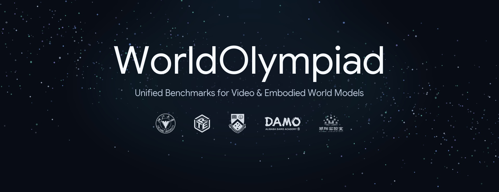
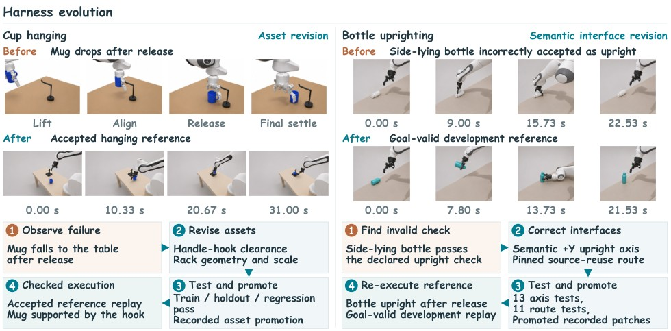
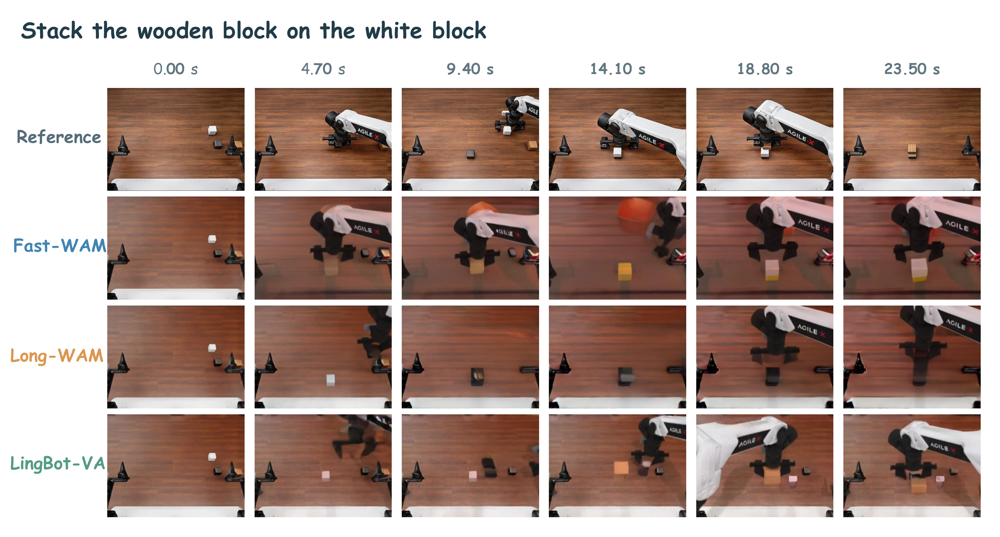

<div align="center">

<h1>🏆 WorldOlympiad</h1>

<p><b>面向视频世界模型与具身世界模型的系列评测基准</b></p>

<p>
  <a href="https://alibaba-damo-academy.github.io/WorldOlympiad"></a>
  <a href="https://github.com/alibaba-damo-academy/WorldOlympiad/tree/v1"></a>
  <a href="https://github.com/alibaba-damo-academy/WorldOlympiad/tree/v2"></a>
  <a href="https://huggingface.co/datasets/Chengzhiwww/WorldOlympiad2.0"></a>
  <a href="README.md"></a>
</p>

<br>



<br>

<table>
  <tr>
    <td align="center" width="25%"><b>2,100+</b><br><sub>评测基准案例（1.0 &amp; 2.0）</sub></td>
    <td align="center" width="25%"><b>300</b><br><sub>双臂真机演示视频</sub></td>
    <td align="center" width="25%"><b>13</b><br><sub>主流世界模型全面评测</sub></td>
    <td align="center" width="25%"><b>ρ = 0.90–0.95</b><br><sub>与人工评分高度对齐</sub></td>
  </tr>
</table>

</div>

<br>

> [!IMPORTANT]
> 🚀 **我们正式发布了 WorldOlympiad 2.0！**  
> 全新推出 **WorldOlympiad 2.0**（*面向具身世界模型的自进化 Agent Harness 与连续动作评测*）——包含 **1,100** 个评测案例、**300** 条全新采集的 AgileX Piper 双臂真机演示、**2,500** 次多模型原生协议 Rollout，以及开箱即用的 **Auto-Adapter** 与 **HF 数据集路由 Skill**。  
> 👉 立即体验：[**项目主页 (`#v2`)**](https://alibaba-damo-academy.github.io/WorldOlympiad/#v2) · [**`v2` 代码分支**](https://github.com/alibaba-damo-academy/WorldOlympiad/tree/v2) · [**HuggingFace 数据集**](https://huggingface.co/datasets/Chengzhiwww/WorldOlympiad2.0)

> **生成模型真的能充当可靠的“世界模拟器”，而不只是画面好看的视频生成器吗？**  
> **WorldOlympiad** 系列从 **1.0** 的长视频三项全能评测（**物理 · 3D 几何 · 交互**），演进至 **2.0** 面向具身操作的 **自进化 Agent Harness** 与 **连续动作评测（CAE）**。

---

## ✨ WorldOlympiad 2.0 — 具身世界模型评测（`v2`）

> **WorldOlympiad 2.0: Evaluating Embodied World Models with a Self-Evolving Agent Harness and Continuous Action Evaluation**

<p>
  <a href="https://alibaba-damo-academy.github.io/WorldOlympiad/#v2"></a>
  <a href="#"></a>
  <a href="https://github.com/alibaba-damo-academy/WorldOlympiad/tree/v2"></a>
  <a href="https://huggingface.co/datasets/Chengzhiwww/WorldOlympiad2.0"></a>
  <a href="README.md"></a>
</p>

### 🔁 自进化 Agent Harness
由单一闭环 **Benchmark Agent** 统一编排合成任务构造、物理校验、多模型原生 Rollout 与三轨 + CAE 打分；在冻结评分规则前提下，评测前自动诊断并修复资产碰撞与目标谓词漏洞并通过回归测试。

<p align="center">
  
</p>

<p align="center">
  
  <br><sub><i>评测前闭环自修复：自动定位并修正挂杯间隙碰撞与扶瓶 +Y 朝向判据漏洞。</i></sub>
</p>

### 🎯 连续动作评测（CAE）
单帧视觉打分容易被“精致画质”误导，即便物体几乎未动或动作停顿。**CAE** 直接从 RGB 视频恢复三维物体连续轨迹，在原生帧率（如 30 fps vs. 10 fps）下无重采样地分离**路径保真度（$S_{\mathrm{path}}$）**与**速度节奏（$S_{\mathrm{vel}}$）**。

<p align="center">
  
</p>

### 🤖 多模型 Rollout 对比与新采集双臂真机套件
覆盖 5 个具身世界模型的 **2,500 次原生协议 Rollout**，以及 **300 条新采集的 AgileX Piper 双臂长程操作真机演示**（10 大任务）。

<p align="center">
  
</p>

<p align="center">
  
  <br><sub><i>在线流动视频墙、11 维交互雷达图与细分矩阵请访问 <a href="https://alibaba-damo-academy.github.io/WorldOlympiad/#v2">项目主页 →</a></i></sub>
</p>

---

## 🏅 WorldOlympiad 1.0 — 视频世界模型评测（`v1`）

> **WorldOlympiad: Can Your World Model Survive a Triathlon?**（[arXiv:2606.11129](https://arxiv.org/abs/2606.11129)）

<p>
  <a href="https://alibaba-damo-academy.github.io/WorldOlympiad/#v1"></a>
  <a href="https://arxiv.org/abs/2606.11129"></a>
  <a href="https://github.com/alibaba-damo-academy/WorldOlympiad/tree/v1"></a>
  <a href="https://huggingface.co/datasets/ziplab/WorldOlympiad"></a>
  <a href="https://github.com/alibaba-damo-academy/WorldOlympiad/blob/v1/README_ZH.md"></a>
</p>

面向 **8 个视频世界模型**、**1,000 段长视频**（400 机器人 / 400 游戏 / 200 通用真实场景）的三项全能诊断基准，与人工偏好排序相关性达 **Spearman $\rho = 0.95$**。

<p align="center">
  
</p>

<p align="center">
  
</p>

---

## 🧭 仓库分支导航与快速拉取

各版本代码完全隔离在独立分支中，按需切换即可：

| 版本 | 代码分支 | 核心内容 | 直达入口 |
| :--- | :---: | :--- | :--- |
| **WorldOlympiad 2.0** | [**`v2`**](https://github.com/alibaba-damo-academy/WorldOlympiad/tree/v2) | 具身世界模型评测、自进化 Harness、CAE、Auto-Adapter &amp; HF 数据集路由 Skill | [**进入 `v2` 代码 →**](https://github.com/alibaba-damo-academy/WorldOlympiad/tree/v2) · [指南](docs/v2-guide.md) · [主页 (`#v2`)](https://alibaba-damo-academy.github.io/WorldOlympiad/#v2) |
| **WorldOlympiad 1.0** | [**`v1`**](https://github.com/alibaba-damo-academy/WorldOlympiad/tree/v1) | 视频世界模型三项全能评测（机器人 / 游戏 / 真实世界） | [**进入 `v1` 代码 →**](https://github.com/alibaba-damo-academy/WorldOlympiad/tree/v1) · [指南](docs/v1-guide.md) · [主页 (`#v1`)](https://alibaba-damo-academy.github.io/WorldOlympiad/#v1) |
| **项目主页源码** | [**`website`**](https://github.com/alibaba-damo-academy/WorldOlympiad/tree/website) | 1.0 &amp; 2.0 一体化交互项目主页（GitHub Pages） | [**访问在线主页 →**](https://alibaba-damo-academy.github.io/WorldOlympiad) |

```bash
# 拉取 WorldOlympiad 2.0 代码
git clone -b v2 https://github.com/alibaba-damo-academy/WorldOlympiad.git

# 拉取 WorldOlympiad 1.0 代码
git clone -b v1 https://github.com/alibaba-damo-academy/WorldOlympiad.git
```

---

## 📚 技术文档索引（`docs/`）

- [WorldOlympiad 2.0 快速指南](docs/v2-guide.md) · [WorldOlympiad 1.0 快速指南](docs/v1-guide.md)
- [V2 自进化 Auto-Adapter Skill](https://github.com/alibaba-damo-academy/WorldOlympiad/blob/v2/.agents/skills/wov2-auto-model-adapter/SKILL.md) · [V2 HF 数据集路由 Skill](https://github.com/alibaba-damo-academy/WorldOlympiad/blob/v2/.agents/skills/wov2-hf-dataset-router/SKILL.md)
- [V2 评测契约与适配器规范](docs/benchmark.md) · [V2 环境迁移指南](docs/migration-v1.md)
- [V2 验收标准](docs/acceptance.md) · [V2 多模型原生接入验证记录](docs/native-multimodel-validation.md)
