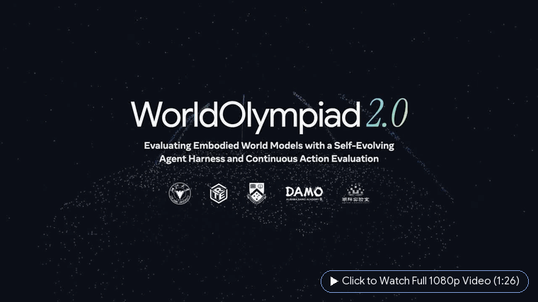
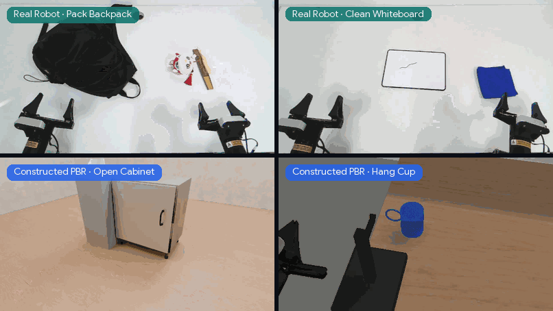
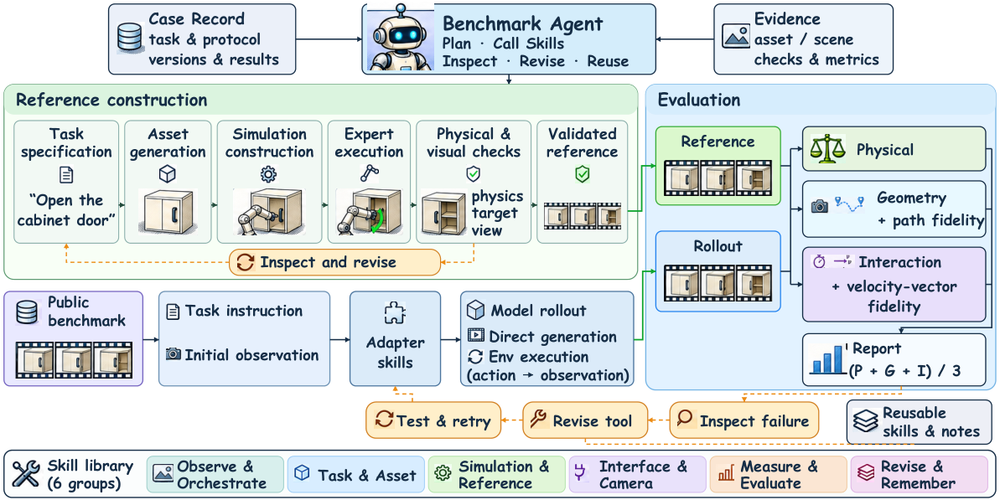
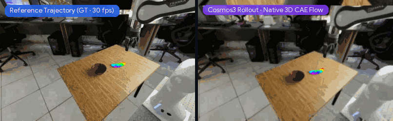
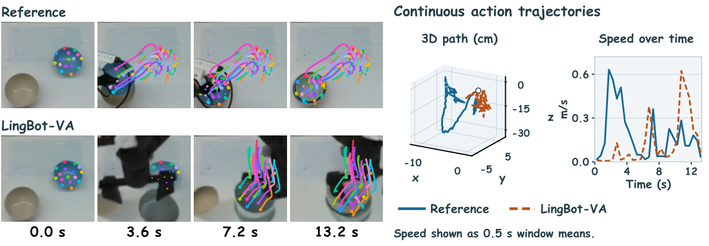
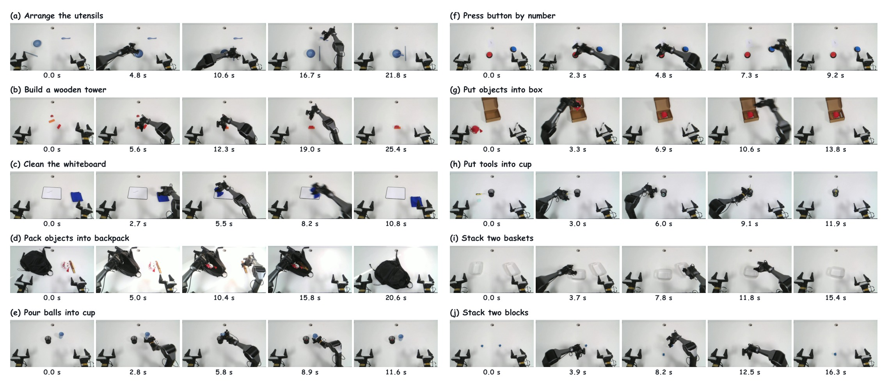
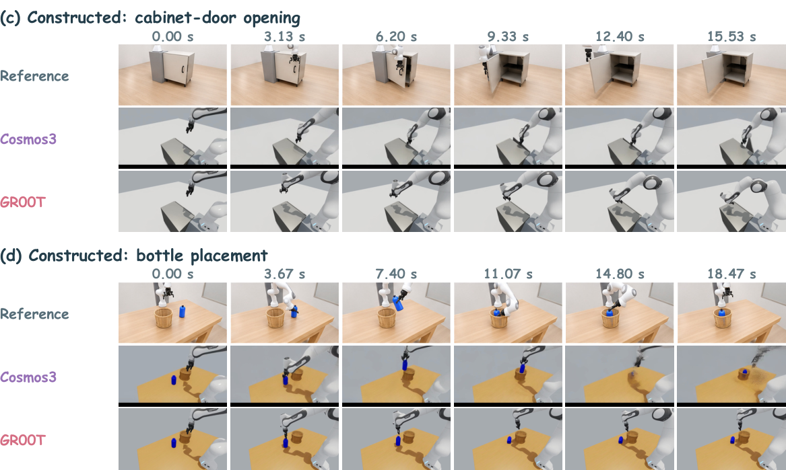

<div align="center">

<h1>WorldOlympiad 2.0：基于自进化 Agent Harness 与连续动作评测的具身世界模型基准</h1>

<p>
  <b>Chengzhi Wang</b><sup>1,*</sup>,
  <b>Yuke Zhao</b><sup>1,*</sup>,
  <b>Zanyang Huang</b><sup>1</sup>,
  <b>Zeyu Zhang</b><sup>2,†</sup>,
  <b>Shiyuan Zhang</b><sup>1</sup>,<br>
  <b>Weijie Wang</b><sup>1</sup>,
  <b>Akide Liu</b><sup>3</sup>,
  <b>Jiasheng Tang</b><sup>4,5</sup>,
  <b>Yinghao Yu</b><sup>2</sup>,
  <b>Bohan Zhuang</b><sup>1,4,‡</sup>
</p>

<p>
  <sup>1</sup> 浙江大学 &nbsp;·&nbsp;
  <sup>2</sup> 阿里巴巴集团 TRE &nbsp;·&nbsp;
  <sup>3</sup> 莫纳什大学 &nbsp;·&nbsp;
  <sup>4</sup> 阿里巴巴达摩院 &nbsp;·&nbsp;
  <sup>5</sup> 湖畔实验室<br>
  <sub><sup>*</sup> 共同一作 &nbsp;·&nbsp; <sup>†</sup> 项目负责人 &nbsp;·&nbsp; <sup>‡</sup> 通讯作者</sub>
</p>

<p>
  <a href="https://alibaba-damo-academy.github.io/WorldOlympiad/#v2"></a>
  <a href="#"></a>
  <a href="https://github.com/alibaba-damo-academy/WorldOlympiad/tree/v2"></a>
  <a href="https://huggingface.co/datasets/Chengzhiwww/WorldOlympiad2.0"></a>
  <a href="README.md"></a>
</p>

<br>

<a href="https://alibaba-damo-academy.github.io/WorldOlympiad/assets/v2/video/promo_web.mp4">
  
</a>
<p><sub>🎬 <a href="https://alibaba-damo-academy.github.io/WorldOlympiad/assets/v2/video/promo_web.mp4"><b>点击播放 1080p 有声完整宣传片（1:26，MP4）</b></a> &nbsp;·&nbsp; <a href="https://alibaba-damo-academy.github.io/WorldOlympiad/#v2">访问在线项目主页查看 39 条交互视频 →</a></sub></p>

<br>

<table>
  <tr>
    <td align="center" width="25%"><b>1,100</b><br><sub>评测基准案例<br>（900 公开 · 200 物理构造）</sub></td>
    <td align="center" width="25%"><b>300</b><br><sub>全新采集双臂真机<br>长程操作演示</sub></td>
    <td align="center" width="25%"><b>2,500</b><br><sub>多模型原生协议 Rollout<br>（5 大具身世界模型）</sub></td>
    <td align="center" width="25%"><b>ρ = 0.90</b><br><sub>人类偏好排序相关性<br>（10 位人工评审）</sub></td>
  </tr>
</table>

</div>

<br>

> **仅仅画面精致，并不足以让具身世界模型成为可靠的物理模拟器。**  
> **WorldOlympiad 2.0** 提出面向具身世界模型的**自进化 Agent Harness**（闭环自动化完成物理任务构造、资产与谓词自修复、多模型原生协议 Rollout 与三轨评分），并引入**连续动作评测（CAE）**，在各模型原生帧率下精确度量三维物体轨迹路径与速度节奏。

---

## 🎬 动态视觉展示

<p align="center">
  
  <br><sub><i>上排：全新采集的 AgileX Piper 双臂真机长程操作演示；下排：物理校验的 PBR 构造仿真操作任务。更多 39 条流动视频与交互演示请访问 <a href="https://alibaba-damo-academy.github.io/WorldOlympiad/#v2">项目主页 →</a></i></sub>
</p>

---

## 🔁 自进化 Agent Harness

区别于脆弱的一次性评测脚本，单一闭环 **Benchmark Agent** 统一编排合成任务构造（`SceneCode` + PyBullet）、物理与目标谓词校验、多模型原生协议 Rollout 与三轨 + CAE 评分。当构造场景中出现资产穿模或谓词漏洞时，Agent 会自动定位根因、修复代码/Skill 并通过回归测试，随后在**冻结评分规则**下公平评测所有模型。

<p align="center">
  
</p>

<p align="center">
  
  <br><sub><i>评测前闭环自修复示例：自动修复挂杯场景挂钩间隙穿模与扶瓶任务 +Y 朝向判据缺陷。</i></sub>
</p>

---

## 🎯 连续动作评测（CAE）

传统单帧视觉打分容易被“精致静止画质”误导——即便目标物体几乎未动或在动作块之间明显卡顿。**CAE** 直接从 RGB 视频恢复三维物体稠密粒子轨迹，在模型**原生帧率**（如 30 fps vs. 10 fps）下无需重采样，将**路径保真度（$S_{\mathrm{path}}$）**与**速度节奏（$S_{\mathrm{vel}}$）**清晰解耦。

<p align="center">
  
  <br><sub><i>原生帧率 3D 粒子流追踪对比：左为真值参考轨迹（GT），右为 Cosmos3 Rollout。</i></sub>
</p>

<p align="center">
  
</p>

---

## 🤖 多模型原生 Rollout 对比与新采集双臂真机套件

我们在 **5 个代表性具身世界模型**（`GR00T N1.6`、`LingBot-VA`、`Long-WAM`、`Fast-WAM`、`Cosmos3`）上完成了 **2,500 次原生协议 Rollout**，覆盖 **900 个公开基准案例**（`RoboDojo`、`ManiSkill3`、`Table30`、`RoboCOIN`、`RoboMIND`）与 **200 个物理校验构造场景**（`ARX5` 双臂与 `Panda` 单臂），并全新采集了 **300 条 AgileX Piper 双臂真机演示**（10 个长程操作任务）。

<p align="center">
  
</p>

<p align="center">
  
</p>

<p align="center">
  
</p>

---

## 🏆 评测榜单与人工偏好对齐

| 排名 | 模型 | 综合得分 | 物理真实 ($P$) | 3D 几何 ($G$) | 交互保真 ($I$) | CAE 路径 ($S_{\mathrm{path}}$) | CAE 速度 ($S_{\mathrm{vel}}$) | 人工评分 |
| :---: | :--- | :---: | :---: | :---: | :---: | :---: | :---: | :---: |
| 🥇 | **GR00T N1.6** | **0.643** | **0.920** | **0.547** | **0.460** | 0.239 | 0.146 | 0.595 |
| 🥈 | **LingBot-VA** | 0.519 | 0.735 | 0.388 | 0.433 | 0.246 | 0.159 | **0.608** |
| 🥉 | **Long-WAM** | 0.496 | 0.726 | 0.390 | 0.373 | 0.243 | 0.157 | 0.512 |
| 4 | **Fast-WAM** | 0.454 | 0.702 | 0.340 | 0.320 | 0.242 | 0.156 | 0.487 |
| 5 | **Cosmos3** | 0.439 | 0.685 | 0.342 | 0.289 | **0.382** | **0.183** | 0.435 |

> **核心发现**：在 10 位人工评审基准上，WorldOlympiad 2.0 达到 **Spearman $\rho = 0.90$** 的高相关性，并揭示了视觉质量与动作连续性的显著分化——视觉保真度领先的 `GR00T N1.6` 在连续动作轨迹与速度上偏弱，而 `Cosmos3` 在 CAE 指标上表现最优（$S_{\mathrm{path}} = 0.382$，$S_{\mathrm{vel}} = 0.183$）。完整 11 维交互雷达图与任务族细分矩阵请访问 [项目主页 →](https://alibaba-damo-academy.github.io/WorldOlympiad/#v2)

---

## 仓库目录结构

```text
WorldOlympiad (branch: v2)
  .agents/skills/                 # 内置三大 Agent Skill（全流程编排、HF 数据路由、自动模型适配）
  CLAUDE.md                       # 编码智能体自动加载的仓库规则
  setup.sh                        # 统一 CLI 入口（安装、配置、数据路由、Agent 运行与打分）
  scripts/                        # CLI 脚本（configure, set_api_key, hf_dataset_router, benchmark）
  code/                           # Benchmark Agent、SceneCode、Depth-Anything-3、CuRobo 与原生模型适配器
  assets/                         # 便携式 URDF 与机器人资产包（SHA-256 校验锁定）
  docs/                           # 评测契约规范与文档插图
```

## 安装与配置

完整 GPU 评测支持 Linux x86_64、NVIDIA CUDA 12.8、`python3.10`、`python3.11` 与 `uv`。

### 1. 拉取代码、运行环境与辅助打分权重

在全新的 GPU 主机上按顺序执行一次即可：

```bash
git clone -b v2 https://github.com/alibaba-damo-academy/WorldOlympiad.git WorldOlympiad-v2
cd WorldOlympiad-v2

# 校验内置源码并展开便携式机器人资产
./setup.sh sources-verify
python3 scripts/setup_robot_assets.py

# 安装隔离的 Python 3.10/3.11 运行环境并下载辅助打分权重（VLM、DA3、SAM、CLIP）
export WOV2_GPU_ALLOWLIST=0,1
./setup.sh robotwin-assets-download
./setup.sh runtime --online-install
mkdir -p ./weights_cache
./setup.sh weights-fetch-aux --shared-root ./weights_cache
```

若服务器已有兼容运行环境或共享权重盘，可直接链接复用：

```bash
./setup.sh runtime-reuse --server-root /path/to/compatible/WOV2
./setup.sh weights-reuse --shared-root /path/to/shared_weights
```

### 2. 配置 GPT API 与模型档案

WorldOlympiad 2.0 将 **GPT / OpenAI 兼容 Agent API**（供 Benchmark Agent 与 SceneCode 使用）与**本地待测世界模型**分开配置：

```bash
./setup.sh configure \
  --agent-base-url https://api.openai.com/v1 \
  --agent-model gpt-5.6-sol \
  --tested-model lingbot_va \
  --checkpoint /absolute/path/to/model_checkpoint

./setup.sh set-api-key
```

`set-api-key` 会无回显地将 `WO_AGENT_API_KEY` 保存在 `.gitignore` 忽略的 `.secrets/scenecode.env` 中（权限 `0600`）；免交互更新可使用 `--from-env OPENAI_API_KEY --replace`。

---

## 基于 Agent 的评测 Pipeline 指南

WorldOlympiad 2.0 原生面向 **Agent 驱动**设计。在任意支持 Skill 的编码智能体（Claude Code、Codex、Cursor、Antigravity 等）中打开本仓库，Agent 会自动加载 [`CLAUDE.md`](CLAUDE.md) 与 `.agents/skills/` 下的三大成熟 Skill：

| 内置 Skill | 核心职责 |
| --- | --- |
| [`wov2-benchmark-pipeline`](.agents/skills/wov2-benchmark-pipeline/SKILL.md) | 驱动合成物理任务构造（`SceneCode` + RSI 闭环自修复）与内置已适配模型评测。 |
| [`wov2-hf-dataset-router`](.agents/skills/wov2-hf-dataset-router/SKILL.md) | 从 HuggingFace 自动路由并物化与模型构型匹配的测试集（`sim_and_real` / `sim_only`）。 |
| [`wov2-auto-model-adapter`](.agents/skills/wov2-auto-model-adapter/SKILL.md) | 自动探查新模型仓库协议、合成并验证适配器，并将经验沉淀回共享注册表。 |

下面按评测流水线的 4 个核心环节依次说明——**直接把自然语言指令发给你的 Agent 即可自动执行**，同时也附上底层等价 CLI 命令。

### 环节 1：用 Agent 构造与自修复合成物理数据

内置 GPT Benchmark Agent（`wo.agent.run`）会自动串联 `author_task` → `scene`（SceneCode 3D 场景合成）→ `reference`（PyBullet / SAPIEN 专家轨迹执行与松手支撑校验）。若遇到资产穿模、挂钩间隙不足或目标谓词缺陷，Agent 会自动调用 `inspect_scene` + `view_image` 查看日志与渲染图，在独立 RSI worktree 中完成通用修复并通过回归测试，直到物理参考完全验证通过。

**直接发给 Agent 的指令：**
> *“使用 `wov2-benchmark-pipeline` 在 GPU `0,1` 上构造挂杯（cup-hanging）和开柜门（cabinet-articulation）两类新任务（`run_id=synth_01`），并完成全部专家物理参考校验。”*

**等价 CLI 命令：**

```bash
export WOV2_GPU_ALLOWLIST=0,1
./setup.sh preflight-preparation

# 默认构造并校验新物理任务（也可通过 --goal-template my_goal.md 指定多任务族目标）
./setup.sh run --phase prepare --run synth_01
```

### 环节 2：选择已适配好的内置模型直接评测

仓库在 `code/WorldOlympiad-main/wo/models/` 中已原生适配好 5 个代表性具身世界模型，完整保留各模型的原生相机视角、动作空间与帧率：

| `--tested-model` | 模型名称 | 机械臂构型 | 原生协议说明 |
| --- | --- | --- | --- |
| `lingbot_va` | **LingBot-VA** | 双臂（`ALOHA` / `ARX5`） | 10 fps 视频-动作联合生成（支持 `sim_rollout` 与 3 视角 `i2av`） |
| `fastwam` | **Fast-WAM** | 双臂（`ALOHA` / `ARX5`） | 14 维关节目标 RoboTwin 闭环执行 |
| `longwam` | **Long-WAM** | 双臂（`ALOHA` / `ARX5`） | 48 步历史观测 RoboTwin 闭环执行 |
| `cosmos3` | **Cosmos3** | 单臂（`Panda` / `DROID`） | 原生 DROID / Panda 外部视角执行 |
| `gr00t` | **GR00T N1.6-DROID** | 单臂（`Panda` / `DROID`） | 仿真闭环动作块策略（`sim_only`） |

**直接发给 Agent 的指令：**
> *“在 GPU `0,1` 上将待测模型切换为 `lingbot_va`（权重 `/data/ckpts/lingbot-va`），基于已校验的 `synth_01` 运行原生 Rollout、三轨 + CAE 打分并生成 v3 报告。”*

**等价 CLI 命令：**

```bash
export WOV2_GPU_ALLOWLIST=0,1
./setup.sh configure --replace \
  --agent-base-url https://api.openai.com/v1 \
  --agent-model gpt-5.6-sol \
  --tested-model lingbot_va \
  --checkpoint /data/ckpts/lingbot-va

./setup.sh preflight-evaluation && ./setup.sh preflight-scoring
./setup.sh run --phase continue --run synth_01   # 或使用 --phase full 一次跑通环节 1 + 环节 2
```

### 环节 3：使用公开的 HuggingFace 基准数据评测

在开源的 **1,100 个基准案例**（900 公开 + 200 物理构造，[`Chengzhiwww/WorldOlympiad2.0`](https://huggingface.co/datasets/Chengzhiwww/WorldOlympiad2.0)）上评测时，`wov2-hf-dataset-router` 会按模型构型与能力自动分流，并严格**仅提取第 0 帧**作为条件输入：

- **`sim_and_real` 混合模式（除 `GR00T` 外所有模型的默认策略）**：能进仿真跑原生闭环（`sim_rollout`）的就进仿真，不能进仿真的真机或公开视频走条件视频生成（`i2av`）。
- **`sim_only`（`GR00T N1.6-DROID` 等纯闭环策略）**：自动筛选可执行仿真子集（`Constructed/Panda`、`ManiSkill3`），排除真机视频。

| 模型类型 | `--arm` | `--execution` | 自动匹配子集 |
| --- | --- | --- | --- |
| 双臂模型（`LingBot-VA`、`Fast-WAM`、`Long-WAM`） | `dual` | `sim_and_real` | `Constructed/ARX5`、`RoboDojo`（sim）+ `Table30`、`RoboCOIN`（real） |
| 单臂模型（`Cosmos3` 及通用单臂模型） | `single` | `sim_and_real` | `Constructed/Panda`、`ManiSkill3`（sim）+ `RoboMIND`、`Table30`（real） |
| 单臂仅仿真策略（`GR00T N1.6-DROID`） | `single` | `sim_only` | `Constructed/Panda`、`ManiSkill3`（仅 sim） |

**直接发给 Agent 的指令：**
> *“使用 `wov2-hf-dataset-router` 从 `Chengzhiwww/WorldOlympiad2.0` 路由并准备双臂评测子集，在 GPU `0,1` 上完成 `lingbot_va` 评测与三轨 + CAE 打分。”*

**等价 CLI 命令：**

```bash
# 1. 查看数据分布并物化已校验案例为 wov2_benchmark.v1 清单
./setup.sh dataset-route summary
./setup.sh dataset-route materialize \
  --arm dual --execution constructed_only --limit 10 \
  --out-dir outputs/datasets/dual_eval
./setup.sh benchmark-check --manifest outputs/datasets/dual_eval/dataset.json

# 2. 运行生成与打分（若已有预测视频，可直接用 benchmark-score 打分）
export WOV2_GPU_ALLOWLIST=0,1
./setup.sh benchmark-score \
  --manifest outputs/datasets/dual_eval/dataset.json \
  --predictions /path/to/predictions.json \
  --run hf_eval_01
```

### 环节 4：用自进化 Auto-Adapter 自动适配任意新模型

遇到全新的待测模型时，无需手动编写适配脚本。直接把新模型代码与权重路径告诉 Agent，`wov2-auto-model-adapter` 会自动执行 5 步自进化接入闭环：
1. **协议探查**：读取新模型推理代码，自动识别单/双臂构型、相机视角、本体状态（`conditioning_state`）、原生帧率与显存需求；
2. **数据匹配**：调用 `wov2-hf-dataset-router` 自动匹配冒烟子集与完整 `sim_and_real` / `sim_only` 测试集；
3. **自动封装**：在 `outputs/adapters/<model>/` 下生成符合 `wov2_adapter.v1` 规范的封装脚本与 `adapter.json`（严格隔离第 0 帧条件输入）；
4. **分级校验**：依次通过 `benchmark-check`、单样本 `--generation-only` GPU 冒烟验证与全量三轨 + CAE 打分；
5. **经验沉淀**：将验证通过的协议与转换经验自动写回 [`references/adapter-registry.md`](.agents/skills/wov2-auto-model-adapter/references/adapter-registry.md)，后续同类模型可直接复用。

**直接发给 Agent 的指令：**
> *“使用 `wov2-auto-model-adapter` 在 GPU `0,1` 上接入我的新模型（代码目录 `/path/to/new_model_repo`，权重 `/path/to/ckpt`）：自动探查协议、路由匹配的 WorldOlympiad 2.0 数据、完成 1-case 冒烟校验与全量打分，并将适配经验更新到注册表。”*

**等价 CLI 命令（`adapter.json` 生成后）：**

```bash
export WOV2_GPU_ALLOWLIST=0,1
./setup.sh benchmark-check \
  --manifest outputs/datasets/dual_eval/dataset.json \
  --adapter outputs/adapters/my_model/adapter.json

./setup.sh benchmark-run \
  --manifest outputs/datasets/dual_eval/dataset.json \
  --adapter outputs/adapters/my_model/adapter.json \
  --mode i2av \
  --run my_new_model_eval
```

底层 `wov2_benchmark.v1`、`wov2_adapter.v1` 与 `wov2_predictions.v1` 详细 JSON 字段规范见 [docs/benchmark.md](docs/benchmark.md)。

---

## WorldOlympiad 系列

- **系列总览与文档中心**：[`main` 分支](https://github.com/alibaba-damo-academy/WorldOlympiad/tree/main)
- **WorldOlympiad 1.0（视频世界模型）**：[`v1` 分支](https://github.com/alibaba-damo-academy/WorldOlympiad/tree/v1) · [项目主页 (`#v1`)](https://alibaba-damo-academy.github.io/WorldOlympiad/#v1)
- **一体化交互项目主页**：[`website` 分支](https://github.com/alibaba-damo-academy/WorldOlympiad/tree/website) · [在线访问](https://alibaba-damo-academy.github.io/WorldOlympiad/#v2)

## 引用

如果本仓库对您的研究有所帮助，欢迎引用：

```bibtex
@article{wang2026worldolympiad2,
  title   = {WorldOlympiad 2.0: Evaluating Embodied World Models with a Self-Evolving Agent Harness and Continuous Action Evaluation},
  author  = {Wang, Chengzhi and Zhao, Yuke and Huang, Zanyang and Zhang, Zeyu and Zhang, Shiyuan and Wang, Weijie and Liu, Akide and Tang, Jiasheng and Yu, Yinghao and Zhuang, Bohan},
  year    = {2026}
}
```

## 致谢

WorldOlympiad 2.0 基于 [WorldOlympiad 1.0](https://github.com/alibaba-damo-academy/WorldOlympiad/tree/v1) 及多项开源机器人与视觉生态构建，包括 SceneCode、RoboTwin、Depth Anything 3、CuRobo、SAM3 与 QwenVL 兼容 VLM 后端。
