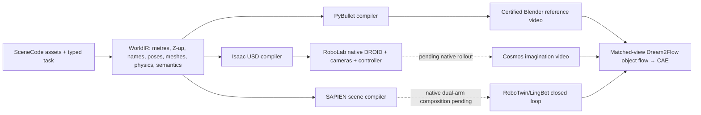

# WorldIR multi-simulator architecture

Status: executable Isaac and SAPIEN scene backends validated on the new server,
2026-08-24. SceneCode visual assets and RoboLab DROID observations are validated
in native Isaac 5.1 RTX; Cosmos closed-loop rollout is the next unverified step.



The reference and WAM branches share scene/task identity, not one simulator's
numerical trajectory. PyBullet remains the scalable reference-data factory.
Cosmos uses RoboLab/Isaac when closed-loop observations are required. The WAM's
predicted actions and native simulator states are provenance; CAE still scores
the decoded imagination video against the successful reference video.

## Implemented interface

`autoresearch.worldir_compiler.WorldIRCompiler` exposes:

- `parse_urdf(...)` — import a URDF into WorldIR;
- `to_pybullet(...)` — existing certified PyBullet bundle;
- `prepare_usd(...)` — deterministic, content-addressed Isaac compile plan;
- `to_usd(...)` — USD materialization inside initialized Isaac Sim.
- `prepare_sapien(...)` — deterministic RoboTwin/SAPIEN scene plan;
- `validate_sapien(...)` — build and step that plan in SAPIEN 3.

The command-line compiler remains backward compatible:

```text
python -m autoresearch.cli compile WORLD.json --backend pybullet --output-dir OUT
python -m autoresearch.cli compile WORLD.json --backend isaac-plan --native-body robot --output-dir OUT
python -m autoresearch.cli compile WORLD.json --backend sapien-plan --native-body robot --output-dir OUT
```

Isaac materialization and native validation are separate because `pxr`, PhysX
schemas and RoboLab are supplied by Isaac Sim:

```text
scripts/convert_scenecode_visual_assets_to_usd.py --asset NAME=ASSET.gltf --output-dir VISUALS
scripts/materialize_worldir_isaac_usd.py --plan PLAN.json --visual-asset-manifest VISUALS/visual_asset_manifest.json --output world.usd
scripts/validate_worldir_robolab_native.py --bundle isaac_bundle.json --robot-usd ROBOT.usd --output validation.json
scripts/validate_worldir_sapien.py --plan PLAN.json --output validation.json
```

## Verified result

Canonical Isaac result:
`outputs/worldir_cup_to_tray_isaac_v8_sdf_visual_uri/`

- Scene ID: `cup_to_tray_scenecode_isaac_native_v1`.
- World hash: `df693d147a6647ca68c8527debcee36ad571b526ce04b5b3fbb7c16cbec9e61b`.
- `table`, `cup` and `tray` are WorldIR bodies; `robot` is an explicit native
  RoboLab DROID override.
- The USD preserves 3 visual geometries and 171 separate invisible collision
  geometries, metre units, Z-up, physics scene and WorldIR hash.
- Visuals follow each SDF's exact GLTF URI. Isaac's native converter preserves
  UVs, base color, normal and metallic/roughness textures. A reusable Z-up
  wrapper applies the explicit GLTF Y-up conversion.
- Source GLTF materials use the specification's default `alphaMode=OPAQUE`;
  importer-created opacity links are removed so transparent atlas padding does
  not erase the assets in RTX.
- RoboLab loads the official DROID Franka/Robotiq USD and native left, right and
  wrist cameras. All three observations contain the red cup, blue tray and
  textured table. This is an Isaac observation preflight, not yet a Cosmos
  imagination result.

## Honest capability boundary

One SceneCode sideboard articulation is currently emitted as frozen geometry;
its joint topology remains in the compile plan and the bundle is therefore
marked `semantic_status=partial`. This is valid for cup-to-tray only when that
drawer is irrelevant to the task. Active robots must be delegated to native
runtime. The SAPIEN scene compiler is runtime-validated, but RoboTwin's native
dual-arm embodiment/camera composition is not yet certified. First-class
WorldIR→MJCF also remains unpromoted; the existence of an older converter is
not treated as proof.
